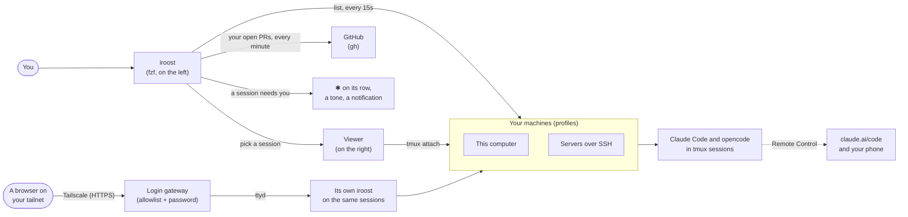

<div align="center">

<pre>
██████████  ████████      ██████      ██████      ████████  ██████████
    ██      ██      ██  ██      ██  ██      ██  ██              ██
    ██      ████████    ██      ██  ██      ██    ██████        ██
    ██      ██    ██    ██      ██  ██      ██          ██      ██
██████████  ██      ██    ██████      ██████    ████████        ██
</pre>

### **i** · personal stack &nbsp;&nbsp; **roost** · where it all nests

**Every Claude Code, agy and opencode session you run, every tmux and terminal session, on every machine you own, in one clickable roost.**<br>
**Your pull requests right under them. Told when a session needs you. Open it from any browser on your tailnet.**


[Quick start](#-quick-start) ·
[What you get](#-what-you-get) ·
[Using it](#-using-it) ·
[In a browser](#in-a-browser) ·
[Profiles](#-profiles) ·
[Settings](#-settings) ·
[Something wrong?](#-something-wrong)

</div>

```
 iroost ───────────────────────────────────────────────
 3 sessions · 1▶ 1⧗ 1· · 1✱
 oracle-sessions ssh · online · 2 ───────────────────
 ▌ ▶ billing-portal                     opus · 12m ●
 ▌   Docker dev data export and import
 ▌   ⎇ feat/docker-dev-data +3 · billing-portal
   · garden                            sonnet · 2h
     Review the tmux layer
     ⎇ main · garden
 macbook-pro-sessions local · online · 1 ────────────
   ⧗ ✱ atlas                             opus · 4m
     ⧗ Do you want to run make test?
     ⎇ feat/fees +7 · atlas


 pull requests victorlazari · gh · 2 ────────────────
   ⧗ #906 fix(auth): refresh expired tokens sil… 2h
     billing-portal · ⎇ fix/token-refresh · revie…
   ✓ #1398 chore: bump dependencies              3d
     atlas · ⎇ chore/deps · checks passed
 ────────────────────────────────────────────────────
  [≡ menu]  [↻]
```

<p align="center"><sub>iroost, on the left of your terminal. Pick a session and the viewer, on the right, shows it live.</sub></p>

---

## 🪺 The name

| | |
|---|---|
| **i** | *your personal stack*: your machines, your agents, your repositories, your pull requests. Yours, not a team's dashboard. |
| **roost** | *the nest*: the one place where all your tmux sessions, terminal sessions, Claude Code, agy and opencode agents and GitHub pull requests come home to. |

Type `iroost` and it suggests what to do; type `iroost open` and the app opens.

---

## 🚀 Quick start

```sh
git clone https://github.com/victorlazari/iroost.git ~/Github/iroost
cd ~/Github/iroost
./install.sh
```

Then open a new terminal and run:

```sh
iroost open
```

```
$ iroost
iroost: your personal stack, and the roost where your sessions nest.
  iroost open                       open the app: sessions, pull requests and a viewer
  iroost list                       print every session, then your open pull requests
  ...
  iroost help                       every command and setting
```

That's it. The installer sets everything up, walks you through your first profile (a name and the folder with your
repositories, both suggested: usually Enter, Enter) and checks it all at the end.
If anything is off, `iroost doctor` tells you what is wrong and how to fix it. Typing only `iroost` (no command) lists what to try.

### Moving from lzr1-panel

iroost is the new name of lzr1-panel. In the folder you cloned, run `git remote set-url origin https://github.com/victorlazari/iroost.git`,
`git pull`, then `./install.sh` again: it moves your profiles, layout and cache to `~/.config/iroost` and `~/.cache/iroost`,
removes the old command, skill link and shell hook, and installs the new ones. Then:

- the command is `iroost` (`iroost open` opens the app); `lzr1-panel` no longer exists;
- every `LZR1_*` setting is now `IROOST_*` (`LZR1_SPLASH=0` is `IROOST_SPLASH=0`): change them in your own shell files;
- tmux layouts opened before the move run on the old `lzr1` server until you close them.

---

## ✨ What you get

| | |
|---|---|
| 🖥 **All your machines** | This computer and any server over SSH, each one a *profile*. A machine that does not answer is left out until it does. |
| 📋 **Every session, at a glance** | Three lines each: its state (`▶` working, `⧗` waiting on you, `·` idle; `✱` finished or asking since you last looked), name, model and age; what Claude is doing, or the question it is waiting on; its git branch and folder. |
| 🤖 **agy and opencode too** | New `agy` (`--dangerously-skip-permissions`) and `opencode` (`--auto`) sessions start from the same keys, menus and shortcuts, and are listed and alerted like Claude's (models `agy` and `opencode`). |
| 🔔 **Told when it's your turn** | When a session finishes its reply or asks you something, its row gets `✱`, a tone plays and your system shows a detailed notification with the tmux session name, profile, repo/branch, and the exact agent request or completion summary (macOS and Linux). Looking at it in the viewer clears the mark. |
| 🔀 **Your pull requests** | Below the sessions, the open PRs of the GitHub account on this computer, found by itself. `✓` checks passed · `✗` failed or changes requested · `⧗` running or waiting for review · `◌` draft. |
| 👆 **Click to view** | Click a session and the viewer on the right shows it, live, with your keyboard in it. The arrow keys only show it; Enter moves the keyboard there. |
| 🖱 **Right-click menus** | On a session: links, copy, rename, end. On a PR: open it, ask Claude to review it or fix its checks, merge. |
| 📱 **Remote Control** | Every session is also on your phone and at claude.ai/code. |
| 🌐 **iroost in a browser** | One key publishes the whole roost to your tailnet, behind your Tailscale login and a password: use it from another laptop or a phone, as here. See [docs/remote.md](docs/remote.md). |
| 🐾 **A Pokémon for every session** | Each session gets one of the first 151, from a hash of its name, kept until the session ends and changeable with `p`. Its mood is the state iroost already tracks: `!` waiting on you, `✓` finished and not looked at yet, `zZz` idle for 3 minutes. Half-block sprites beside each card (text tags without ImageMagick), turned on or off from `[≡ menu]` in the footer; and in a browser a strip where they walk, stroll and sleep. See [docs/pokemon.md](docs/pokemon.md). |
| 🛟 **Sessions survive** | If Claude, agy or opencode exits (two Ctrl-Cs, Claude's `/exit`, a crash), the session stays. Enter resumes the same conversation. |
| ✂️ **Copy just works** | Drag to select, Ctrl-C, and it's on your clipboard: in any terminal, from any machine. |

---

## 🧭 How it works



- Each **machine** keeps its Claude Code and opencode sessions in **tmux**, so they run whether iroost is open
  or not.
- **iroost** (the list on the left) asks every machine for its sessions at once (one shared SSH connection per server), and asks
  GitHub for your open pull requests. When a session finishes its reply or asks you something, it marks it,
  plays a tone and shows a system notification.
- The **viewer** attaches to the session you pick. Leave it with `Ctrl-b d`, and the session keeps going.
- **In a browser**, `tailscale serve` publishes a login gateway on your tailnet; past it, each browser gets its own
  iroost and viewer, on the same tmux sessions ([docs/remote.md](docs/remote.md)).

---

## 🎮 Using it

### The list

| Do this | And this happens |
|---|---|
| **click** a row | the session shows in the viewer, and the keyboard moves there |
| `↑` `↓` | the session shows in the viewer; the keyboard stays in the list |
| **enter** or double-click | you type in that session (on a PR: it opens in the browser) |
| **right-click**, or `m` | the row's menu |
| **`[≡ menu]`** (footer) | opens the footer menu list: new Opus / Sonnet / Agy / opencode sessions, refresh, web, full, Pokémon theme, keys, quit (never clips when the sidebar is narrow) |
| **`[↻]`** (footer), or `r` | refreshes sessions and pull requests with a live spinner (`[⠋ refreshing…]` → `[✓ refreshed]`), plus automatic refresh every 15 seconds |
| `n` / `s` | a new Opus / Sonnet session (type a name, or click a repository) |
| `a` | a new Agy session, with `--dangerously-skip-permissions` |
| `c` | a new opencode session, with auto-approve on (`--auto`) |
| `t` | the session in a new Ghostty tab |
| `o` | its Remote Control link (on a PR: the PR) |
| `p` | choose the session's Pokémon (type a name or a number, enter or click) |
| `x` | ends the session: stops the agent and closes its tmux session (asks first), then shows the first one left |
| `f` | the viewer alone, so a terminal app's own text selection (Termius on a phone) stays inside the session; tap the yellow bar at the bottom to bring the list back |
| `w` | iroost in a browser: turns it on (asks who may come in, copies the URL); while it is on, its menu: copy the URL or the password, who is connected, rotate the password, turn it off |
| `r` | refresh (it also refreshes every 15 seconds) |
| `?` / `q` | all the keys / quit: closes iroost, the viewer and the window |

In a narrow window (a phone, or a tmux layout under `IROOST_NARROW` columns), the list and the session show one at a
time: tap a session to open it, `Ctrl-b d` to come back to the list.

### The viewer

- **`Ctrl-b d`** leaves the session (it keeps running).
- **Ctrl-C** goes to Claude (or opencode), unless text is selected: then it copies.

### The right-click menu

| On a session | On a pull request |
|---|---|
| view it, or view it and type in it | open it, its checks or its files |
| open it in a new Ghostty tab | copy its link or its branch |
| open or copy its Remote Control link | start a session on its repository |
| open its pull request (when its branch has one) | **ask Claude to review it** |
| open its repository on GitHub, or its folder | **ask Claude to fix its failing checks** |
| copy the command that attaches to it | re-run failed checks |
| new Claude or opencode session · interrupt it · rename | mark it ready for review |
| end it: stop Claude, close its tmux session, show the first one left | merge or close it (both ask first) |

A machine's heading has a menu too: new Opus, Sonnet or opencode sessions there, test the machine, edit or remove
its profile (removing asks first; its sessions keep running in tmux, and the viewer moves to another machine's
session), refresh.

### Copying text

> [!TIP]
> In a session: **drag** over the text (Claude highlights it), press **Ctrl-C**, then paste with **Cmd-V**.

- **Cmd-C does not copy inside a session.** Your terminal keeps Cmd-C for its own selection, which is empty while
  Claude has the mouse. Use Ctrl-C.
- **Prefer your terminal's own selection?** Turn mouse reporting off while you select (macOS Terminal: **Cmd-R**;
  Ghostty: hold **Shift**; iTerm2: hold **Option**), then Cmd-C. This also works in the list.

Not copying? See [Copying text](docs/troubleshooting.md#copying-text).

### In a browser

Press **`w`** (or click **`[web]`**) and iroost is published to your tailnet: any browser there, on another laptop
or a phone, opens the URL, types the password and gets its own iroost on the same sessions, with the same keys and
menus. The first time, it asks which Tailscale logins may come in; then it shows the URL and the password, and copies
the URL. While it is on, the summary line ends in `⇄ web`, and `w` opens its menu: copy the URL, copy the password,
who is connected, rotate the password (every browser is logged out), turn it off. In a browser, `w` offers
only the two copies and who is connected, so a browser never cuts off the remote it is using.

Only your tailnet can reach it (never Funnel), only the logins you allow, and only with the password; it turns itself
off after 8 hours, and a browser left idle is logged out after 30 minutes. It needs Tailscale with HTTPS certificates
on, ttyd and Go (the installer offers both); `iroost doctor` checks them. Setup, safety and the details:
**[docs/remote.md](docs/remote.md)**. Something wrong: [Remote, in a browser](docs/troubleshooting.md#remote-panel-in-a-browser).

### From the command line

```sh
iroost                                  # what to try, short (iroost help: every command)
iroost open                             # open the app
iroost run [--model M] [--effort E]     # Claude here, in a new tmux session, attached; listed when here is
                                            # inside a profile's repositories folder
iroost run --agy                        # agy here (--dangerously-skip-permissions), the same way
iroost run --opencode                   # opencode here (auto-approve on), the same way
iroost start PROFILE opus|sonnet|agy|opencode NAME  # a session, without opening the app
iroost attach PROFILE NAME              # this terminal into a session
iroost list                             # every session, then your PRs
iroost prs                              # your open pull requests
iroost doctor                           # check everything, with fixes: this computer, GitHub, alerts,
                                            # the remote and every profile
iroost notify                           # a sample alert: the tone and a notification
iroost keys                             # every key
iroost profile list|show|add|edit|test|remove   # your machines (see Profiles below)
iroost remote on [--allow EMAIL[,EMAIL]] [--ttl 8h]  # iroost in a browser, on your tailnet: prints the
                                            # URL and password, copies the URL
iroost remote url|password              # copy its URL / its password
iroost remote status|who                # on or off, until when, its logins / who is signed in now
iroost remote rotate                    # a new password: every browser is logged out, the URL stays
iroost remote off                       # unpublish it and stop it all (docs/remote.md)
iroost remote build                     # build the login gateway now (remote on does it when needed)
iroost splash                           # the opening animation
iroost version                          # the version
```

Your shell also gets shortcuts:

- **`cl-opus`** / **`cl-sonnet`**: Claude in the folder you're in, inside a new tmux session, so iroost lists it
  when that folder is inside a profile's repositories folder (a profile lists only the sessions there). If you
  already have your own `cl-opus` or `cl-sonnet`, yours stay; point them at `iroost run` to get the same.
- **`cl-agy`**: agy, with `--dangerously-skip-permissions`, the same way (`iroost run --agy`), listed under the
  same rule. Yours wins here too.
- **`cl-opencode`**: opencode, with auto-approve on, the same way (`iroost run --opencode`), listed under the
  same rule. Yours wins here too.
- **`cl-<profile>-opus NAME`** / **`cl-<profile>-sonnet NAME`** / **`cl-<profile>-agy NAME`** / **`cl-<profile>-opencode NAME`**: a session on that
  profile's machine.

> [!NOTE]
> iroost only sees sessions that run **inside tmux**. A plain `claude` in a terminal tab never shows up: start
> it with `cl-opus`, `iroost run`, or the list's `n` / `s` (`agy`: `cl-agy` or `a`; `opencode`: `cl-opencode` or `c`).

---

## 🗂 Profiles

A profile is a machine. Add one by answering a few questions:

```sh
iroost profile add
```

Or in one line:

```sh
iroost profile add my-mac --local --repos ~/Github/my-repositories
iroost profile add my-server --ssh user@host --key ~/.ssh/my.key --repos '~/my-repositories'
```

A profile lists only the sessions inside its `--repos` folder, so **one machine can have several profiles**, one
folder each, and every session shows once:

```sh
iroost profile add personal --local --repos ~/Github/personal
iroost profile add work --local --repos ~/Github/work
```

Or just ask Claude: *"create a new iroost profile"* ([the guide it follows](docs/profiles.md)).

| Command | What it does |
|---|---|
| `iroost profile list` | your profiles |
| `iroost profile test NAME` | reaches it and checks tmux, Claude, opencode and the folders |
| `iroost profile show NAME` | what it holds |
| `iroost profile edit NAME` | asks its questions again, each showing the current value |
| `iroost profile remove NAME` | removes it |

A session named like a folder in `--repos` opens inside it: `billing-portal` opens in
`~/Github/my-repositories/billing-portal`.

> [!IMPORTANT]
> **Profiles stay private.** They live in `~/.config/iroost/profiles/`, never in this repository: they hold
> hosts and key paths.

An SSH machine needs **tmux** and **Claude Code** (signed in) installed there; **opencode** is optional, for
opencode sessions. `iroost profile test NAME` tells you if something is missing.

---

## 📦 What the installer does

`./install.sh` works on macOS and Linux, and is safe to run again: it only changes what is missing.

1. **Tools**: zsh, tmux, fzf 0.74+, curl, openssl, git, gh and jq.
2. **Claude Code**, and **Ghostty** on macOS (it asks first).
3. **Copying**: Ctrl-C copies a Shift-selection in Ghostty (it asks first).
3b. **The Pokémon theme's tools**: ImageMagick (sprites), through brew on macOS, and on macOS terminal-notifier
   (alerts grouped per session). Both are optional and it asks first.
4. **ttyd and Go**, for iroost in a browser (it asks first). Tailscale is yours to install
   ([tailscale.com/download](https://tailscale.com/download)): the installer only says when it is missing.
5. **The `iroost` command**, in `~/.local/bin`.
6. **The remote's login gateway** (`gateway/`), built with Go when you said yes to step 4, or had both (`remote on` builds it otherwise).
7. **The Claude Code skill** that creates profiles.
8. **A shell hook**: the `cl-*` shortcuts (including `cl-opus` / `cl-sonnet` / `cl-opencode`, unless you have your
   own) and, if you want, iroost opening with Ghostty.
9. **GitHub sign-in** (`gh auth login`), so iroost lists your pull requests.
10. **Your first profile**, guided: this computer's name comes from its hostname, the repositories folder is picked from
    the usual places (`~/github`, `~/code`, `~/dev`, ...) or typed, and it then offers to add more machines over SSH.
    Later: `iroost profile add` asks the same questions, with the same suggestions.
11. **`iroost doctor`**, to check it all.

| Option | What it does |
|---|---|
| `./install.sh --yes` | answers yes to everything |
| `./install.sh --no-shell` | leaves your shell files alone |
| `./install.sh --uninstall` | removes it all (your profiles stay) |

---

## ⚙ Settings

Set these in your shell, for example in `~/.zshenv`:

| Setting | Default | What it does |
|---|---|---|
| `IROOST_PANEL_WIDTH` | `56` | the list's width, in columns |
| `IROOST_NARROW` | `86` (the list's width + 30) | a tmux layout narrower than this (a phone) shows the list or the session, one at a time; `0` never does |
| `IROOST_MENU_BUTTON` | `right` | `left` opens menus with the left button |
| `IROOST_PRS` | `1` | `0` hides the pull requests |
| `IROOST_POKEMON` | `sprite` | `sprite`: a sprite beside each card (needs curl and ImageMagick, which `./install.sh` installs with brew; else text tags; the panel is 66 columns wide unless `IROOST_PANEL_WIDTH` says otherwise); `text`: a mood and the Pokémon's name on each card; `off`: no Pokémon. Set, it wins over the footer's `[...]` menu, which keeps its choice in `~/.config/iroost/pokemon` |
| `IROOST_POKEMON_SLEEP` | `180` | seconds idle before a Pokémon sleeps (`zZz`) |
| `IROOST_POKEMON_IMAGES` | `auto` | in Ghostty and kitty (outside tmux) the sprites are real pictures (Kitty graphics); `0` always half blocks, `1` pictures wherever the terminal has them |
| `IROOST_SOUND` | `1` | `0` turns the alert tone off; a sound file's path plays that instead |
| `IROOST_NOTIFY` | `1` | `0` turns the system notifications off (the `✱` stays) |
| `IROOST_SPLASH` | `1` | `0` skips the opening animation |
| `IROOST_SPLASH_SECONDS` | `5` | how long the animation lasts |
| `IROOST_PANEL` | `1` | `0` stops iroost opening with Ghostty |
| `IROOST_CONFIG` | `~/.config/iroost` | where your profiles live |
| `IROOST_REMOTE_TTL` | `8h` | how long iroost in a browser stays on (`remote on --ttl` wins over it): `8h`, `90m`, `1h30m` |
| `IROOST_REMOTE_IDLE` | `30m` | a browser that sends no input for this long is logged out and its session ends |
| `IROOST_REMOTE_NOTIFY` | `1` | `0` turns off the remote's alerts (logins, wrong passwords); `IROOST_NOTIFY=0` does not |
| `IROOST_REMOTE_PWLEN` | `16` | the remote's password length, 12 at least |

---

## 🛟 Something wrong?

Run this first:

```sh
iroost doctor
```

Then see **[docs/troubleshooting.md](docs/troubleshooting.md)**: every common problem, and how to fix it.

---

## 🧱 Inside the repository

```
bin/iroost                      the command: list, viewer, sessions, PRs, menus, profiles, remote
gateway/                        the remote's login gateway, iroost-remote-gw (Go, standard library only)
lib/splash.zsh                  the opening animation
install.sh                      the installer, for macOS and Linux (and the move from lzr1-panel)
tests/                          the command line, the migration, the freeze guards, the version rules
docs/troubleshooting.md         problems and their fixes
docs/remote.md                  iroost in a browser, over Tailscale: setup, safety, turning it off
docs/profiles.md                how to create a profile (for people and AI assistants)
docs/*-options.html             the designs considered: splash, sidebar, PR section, menus
skills/iroost-profiles/         the Claude Code skill that creates profiles
AGENTS.md                       pointers for AI assistants working here
```

## 🤝 Contributing

Changes are welcome. Before opening a pull request, check the scripts parse:

```sh
zsh -n bin/iroost lib/splash.zsh
bash -n install.sh          # it must also run on macOS's bash 3.2
sh tests/cli.sh && bash tests/migrate.sh && sh tests/next-version.sh
cd gateway && go vet ./... && go test ./... -race   # the remote's gateway
```

Scripts sent to a profile's machine run as POSIX `sh`. [AGENTS.md](AGENTS.md) has the rest.

<div align="center">
<sub>Made for people who run Claude Code everywhere.</sub>
</div>

## 🐾 Credits

The Pokémon idea comes from [herdr-pokemon-agents](https://github.com/mathieucroset/herdr-pokemon-agents). Sprites are
[PMD SpriteCollab](https://github.com/PMDCollab/SpriteCollab) by the PMDCollab artists, CC BY-NC 4.0 (per-sprite credits
in their repository); they are downloaded when first needed and never shipped here. Pokémon and all related names are
trademarks of Nintendo, Creatures and GAME FREAK; this is an unofficial fan feature, not affiliated with them.
